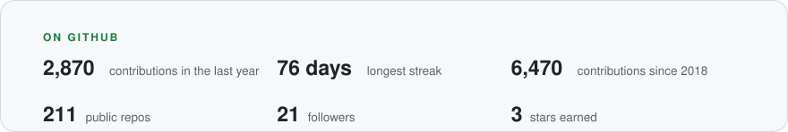
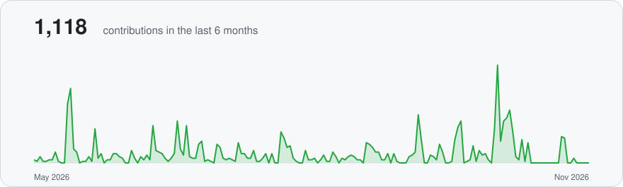
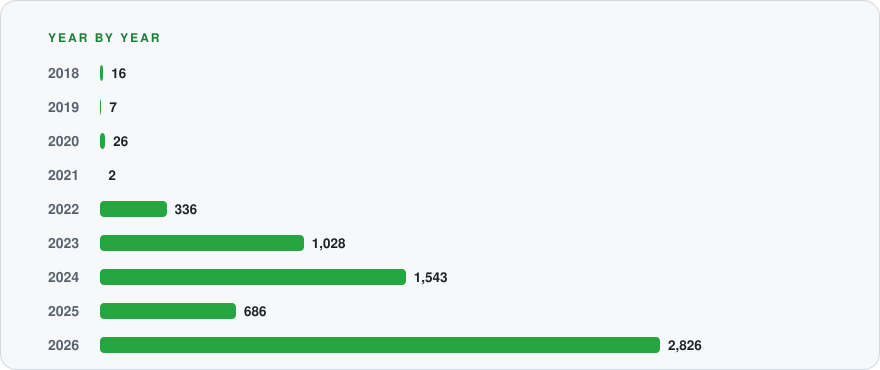

<a href="https://hirenthakore.com"><picture><source media="(prefers-color-scheme: dark) and (max-width: 600px)" srcset="assets/hero-phone-dark.svg"><source media="(max-width: 600px)" srcset="assets/hero-phone-light.svg"><source media="(prefers-color-scheme: dark)" srcset="assets/hero-dark.svg"></picture></a>

<a href="https://hirenthakore.com"><picture><source media="(prefers-color-scheme: dark)" srcset="assets/badge-site-dark.svg"></picture></a>
<a href="https://x.com/hirenthakore"><picture><source media="(prefers-color-scheme: dark)" srcset="assets/badge-x-dark.svg"></picture></a>
<a href="https://linkedin.com/in/hirenthakore"><picture><source media="(prefers-color-scheme: dark)" srcset="assets/badge-linkedin-dark.svg"></picture></a>
<a href="https://github.com/thakoreh"><picture><source media="(prefers-color-scheme: dark)" srcset="assets/badge-github-dark.svg"></picture></a>

<picture><source media="(prefers-color-scheme: dark) and (max-width: 600px)" srcset="assets/github-phone-dark.svg"><source media="(max-width: 600px)" srcset="assets/github-phone-light.svg"><source media="(prefers-color-scheme: dark)" srcset="assets/github-dark.svg"></picture>

<picture><source media="(prefers-color-scheme: dark) and (max-width: 600px)" srcset="assets/graph-6m-phone-dark.svg"><source media="(max-width: 600px)" srcset="assets/graph-6m-phone-light.svg"><source media="(prefers-color-scheme: dark)" srcset="assets/graph-6m-dark.svg"></picture>

Last 12 months

<picture><source media="(prefers-color-scheme: dark)" srcset="assets/graph-12m-dark.svg"></picture>

Year by year

<picture><source media="(prefers-color-scheme: dark)" srcset="assets/years-dark.svg"></picture>

## Now building

- **Agent cost visibility** — [agent-tally](https://github.com/thakoreh/agent-tally) tracks spend across coding-agent CLIs. Field note: [why a $0 estimate doesn't prove a run was free](https://github.com/thakoreh/agent-tally/blob/main/docs/cost-accuracy.md).
- **Model benchmarking** — [llm-speedtest-mcp](https://github.com/thakoreh/llm-speedtest-mcp), speedtest.net for LLMs, as an MCP server.
- **Code quality** — [vibecheck](https://github.com/thakoreh/vibecheck) audits AI-generated code for anti-patterns and security issues, with a vibe score.
- **Indie apps** — [ARA Calls](https://aracalls.ca), an AI receptionist for Canadian HVAC and plumbing businesses, and [Paris Pulse](https://parispulse.ca), a local guide for Paris, Ontario.

The graphics above are generated from live GitHub data by [scripts/generate_profile.py](scripts/generate_profile.py).
