<a href="https://hirenthakore.com"><picture><source media="(prefers-color-scheme: dark) and (max-width: 600px)" srcset="assets/hero-phone-dark.svg"><source media="(max-width: 600px)" srcset="assets/hero-phone-light.svg"><source media="(prefers-color-scheme: dark)" srcset="assets/hero-dark.svg">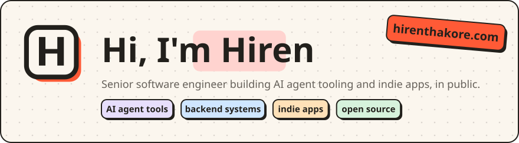</picture></a>

<a href="https://x.com/hirenthakore"><picture><source media="(prefers-color-scheme: dark)" srcset="assets/badge-x-dark.svg"></picture></a>
<a href="https://linkedin.com/in/hirenthakore"><picture><source media="(prefers-color-scheme: dark)" srcset="assets/badge-li-dark.svg"></picture></a>
<a href="https://hirenthakore.com"><picture><source media="(prefers-color-scheme: dark)" srcset="assets/badge-site-dark.svg"></picture></a>

<picture><source media="(prefers-color-scheme: dark) and (max-width: 600px)" srcset="assets/github-phone-dark.svg"><source media="(max-width: 600px)" srcset="assets/github-phone-light.svg"><source media="(prefers-color-scheme: dark)" srcset="assets/github-dark.svg"></picture>

<picture><source media="(prefers-color-scheme: dark) and (max-width: 600px)" srcset="assets/graph-6m-phone-dark.svg"><source media="(max-width: 600px)" srcset="assets/graph-6m-phone-light.svg"><source media="(prefers-color-scheme: dark)" srcset="assets/graph-6m-dark.svg"></picture>

Last 12 months: 2,906 contributions

<picture><source media="(prefers-color-scheme: dark) and (max-width: 600px)" srcset="assets/graph-12m-phone-dark.svg"><source media="(max-width: 600px)" srcset="assets/graph-12m-phone-light.svg"><source media="(prefers-color-scheme: dark)" srcset="assets/graph-12m-dark.svg">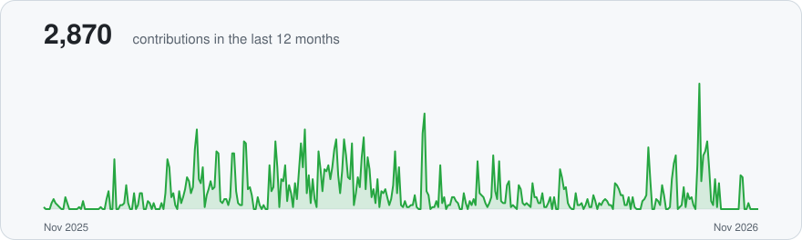</picture>

2026: 2,855 contributions

<picture><source media="(prefers-color-scheme: dark) and (max-width: 600px)" srcset="assets/graph-2026-phone-dark.svg"><source media="(max-width: 600px)" srcset="assets/graph-2026-phone-light.svg"><source media="(prefers-color-scheme: dark)" srcset="assets/graph-2026-dark.svg">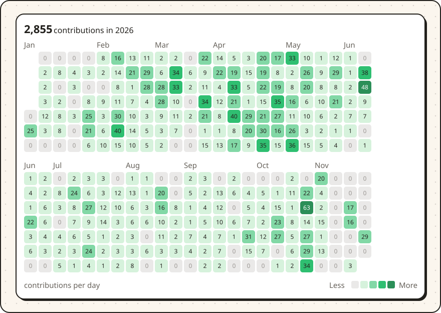</picture>

2025: 684 contributions

<picture><source media="(prefers-color-scheme: dark) and (max-width: 600px)" srcset="assets/graph-2025-phone-dark.svg"><source media="(max-width: 600px)" srcset="assets/graph-2025-phone-light.svg"><source media="(prefers-color-scheme: dark)" srcset="assets/graph-2025-dark.svg">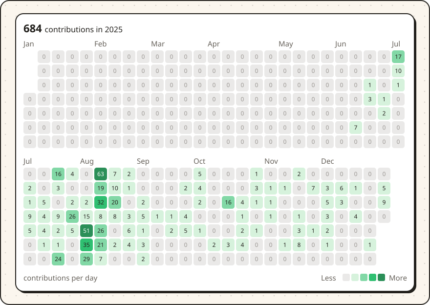</picture>

2024: 1,543 contributions

<picture><source media="(prefers-color-scheme: dark) and (max-width: 600px)" srcset="assets/graph-2024-phone-dark.svg"><source media="(max-width: 600px)" srcset="assets/graph-2024-phone-light.svg"><source media="(prefers-color-scheme: dark)" srcset="assets/graph-2024-dark.svg">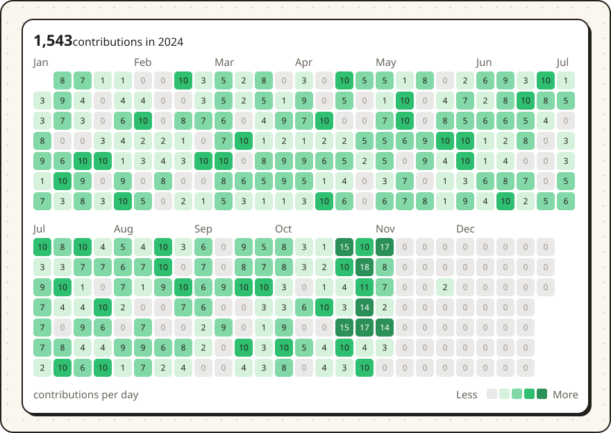</picture>

2023: 1,028 contributions

<picture><source media="(prefers-color-scheme: dark) and (max-width: 600px)" srcset="assets/graph-2023-phone-dark.svg"><source media="(max-width: 600px)" srcset="assets/graph-2023-phone-light.svg"><source media="(prefers-color-scheme: dark)" srcset="assets/graph-2023-dark.svg">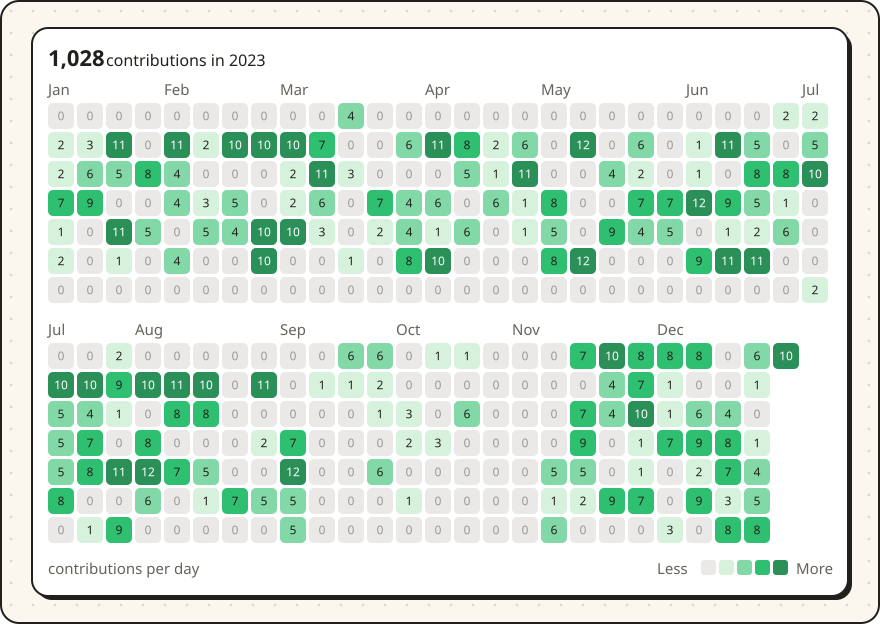</picture>

2022: 336 contributions

<picture><source media="(prefers-color-scheme: dark) and (max-width: 600px)" srcset="assets/graph-2022-phone-dark.svg"><source media="(max-width: 600px)" srcset="assets/graph-2022-phone-light.svg"><source media="(prefers-color-scheme: dark)" srcset="assets/graph-2022-dark.svg">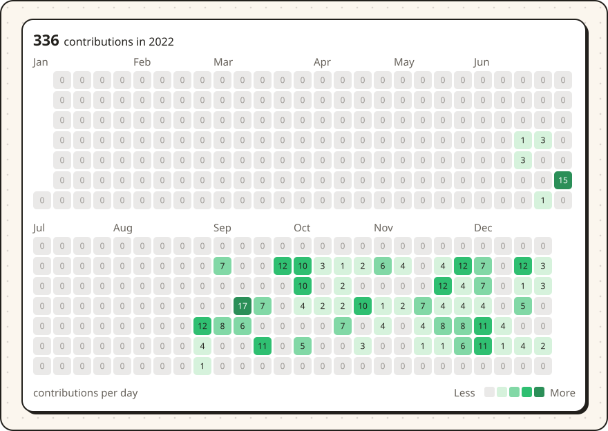</picture>

2021: 2 contributions

<picture><source media="(prefers-color-scheme: dark) and (max-width: 600px)" srcset="assets/graph-2021-phone-dark.svg"><source media="(max-width: 600px)" srcset="assets/graph-2021-phone-light.svg"><source media="(prefers-color-scheme: dark)" srcset="assets/graph-2021-dark.svg">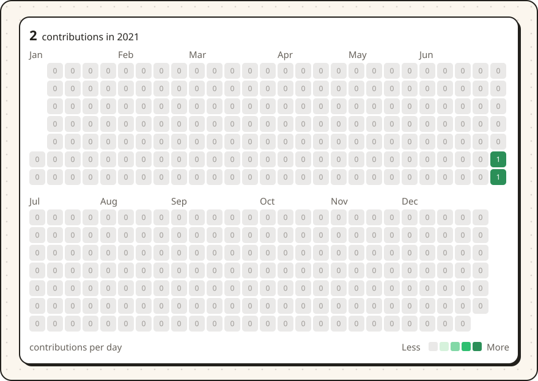</picture>

2020: 26 contributions

<picture><source media="(prefers-color-scheme: dark) and (max-width: 600px)" srcset="assets/graph-2020-phone-dark.svg"><source media="(max-width: 600px)" srcset="assets/graph-2020-phone-light.svg"><source media="(prefers-color-scheme: dark)" srcset="assets/graph-2020-dark.svg">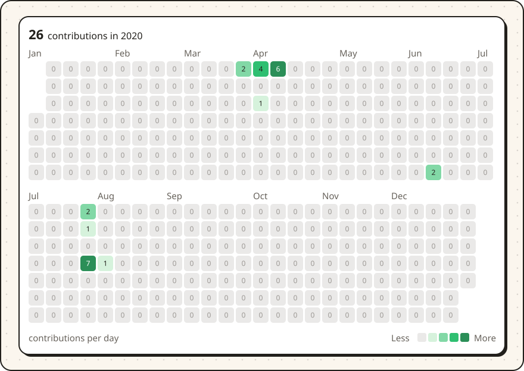</picture>

2019: 7 contributions

<picture><source media="(prefers-color-scheme: dark) and (max-width: 600px)" srcset="assets/graph-2019-phone-dark.svg"><source media="(max-width: 600px)" srcset="assets/graph-2019-phone-light.svg"><source media="(prefers-color-scheme: dark)" srcset="assets/graph-2019-dark.svg">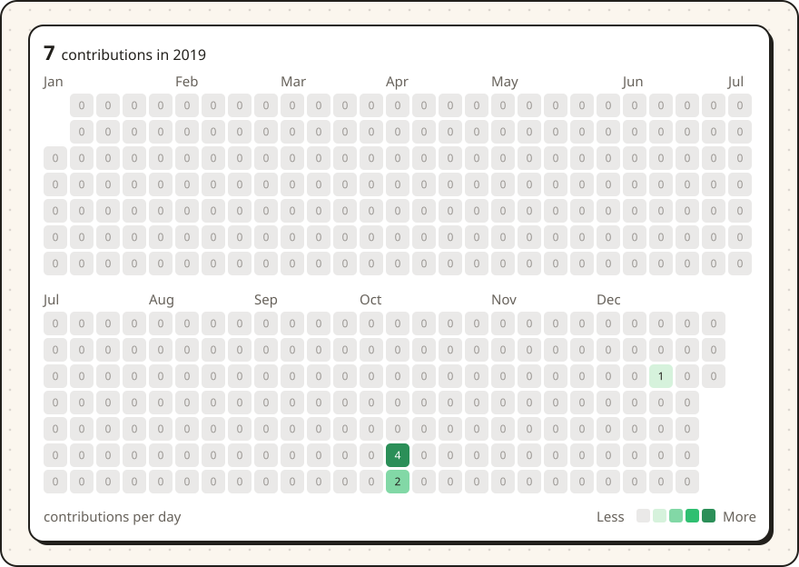</picture>

2018: 16 contributions

<picture><source media="(prefers-color-scheme: dark) and (max-width: 600px)" srcset="assets/graph-2018-phone-dark.svg"><source media="(max-width: 600px)" srcset="assets/graph-2018-phone-light.svg"><source media="(prefers-color-scheme: dark)" srcset="assets/graph-2018-dark.svg">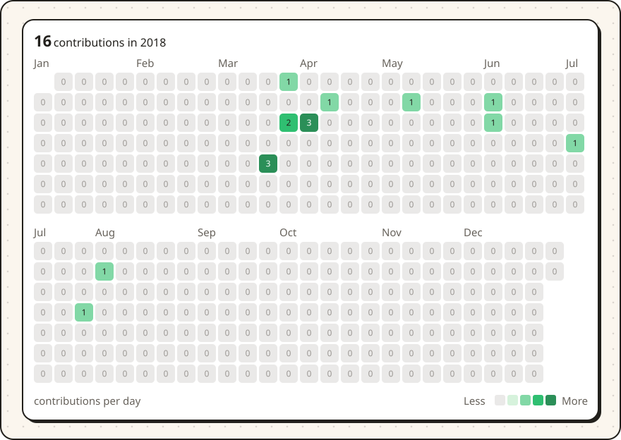</picture>

<picture><source media="(prefers-color-scheme: dark) and (max-width: 600px)" srcset="assets/line-30d-phone-dark.svg"><source media="(max-width: 600px)" srcset="assets/line-30d-phone-light.svg"><source media="(prefers-color-scheme: dark)" srcset="assets/line-30d-dark.svg">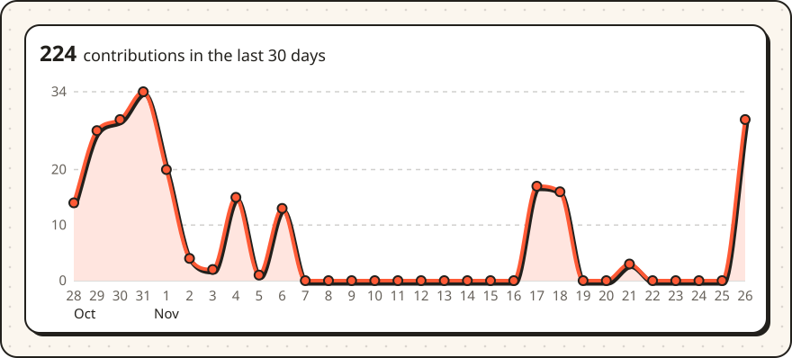</picture>

<picture><source media="(prefers-color-scheme: dark) and (max-width: 600px)" srcset="assets/whoami-phone-dark.svg"><source media="(max-width: 600px)" srcset="assets/whoami-phone-light.svg"><source media="(prefers-color-scheme: dark)" srcset="assets/whoami-dark.svg"></picture>

<picture><source media="(prefers-color-scheme: dark) and (max-width: 600px)" srcset="assets/label-ship-phone-dark.svg"><source media="(max-width: 600px)" srcset="assets/label-ship-phone-light.svg"><source media="(prefers-color-scheme: dark)" srcset="assets/label-ship-dark.svg"></picture>

<a href="https://github.com/thakoreh/agent-tally"><picture><source media="(prefers-color-scheme: dark) and (max-width: 600px)" srcset="assets/app-agent-tally-phone-dark.svg"><source media="(max-width: 600px)" srcset="assets/app-agent-tally-phone-light.svg"><source media="(prefers-color-scheme: dark)" srcset="assets/app-agent-tally-dark.svg">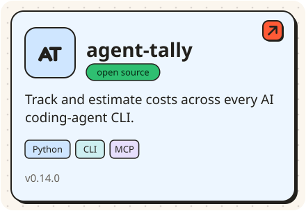</picture></a>
<a href="https://github.com/thakoreh/llm-speedtest-mcp"><picture><source media="(prefers-color-scheme: dark) and (max-width: 600px)" srcset="assets/app-llm-speedtest-mcp-phone-dark.svg"><source media="(max-width: 600px)" srcset="assets/app-llm-speedtest-mcp-phone-light.svg"><source media="(prefers-color-scheme: dark)" srcset="assets/app-llm-speedtest-mcp-dark.svg">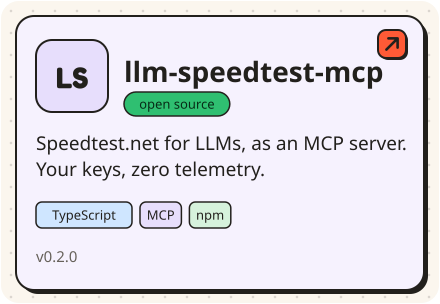</picture></a>
<a href="https://github.com/thakoreh/vibecheck"><picture><source media="(prefers-color-scheme: dark) and (max-width: 600px)" srcset="assets/app-vibecheck-phone-dark.svg"><source media="(max-width: 600px)" srcset="assets/app-vibecheck-phone-light.svg"><source media="(prefers-color-scheme: dark)" srcset="assets/app-vibecheck-dark.svg">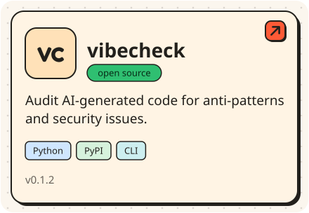</picture></a>
<a href="https://parispulse.ca"><picture><source media="(prefers-color-scheme: dark) and (max-width: 600px)" srcset="assets/app-paris-pulse-phone-dark.svg"><source media="(max-width: 600px)" srcset="assets/app-paris-pulse-phone-light.svg"><source media="(prefers-color-scheme: dark)" srcset="assets/app-paris-pulse-dark.svg">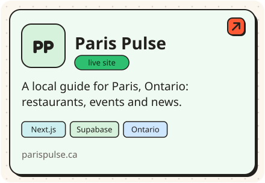</picture></a>

Reelish on <a href="https://play.google.com/store/apps/details?id=com.hiren.simmerlite">Google Play</a> · more ships: <a href="https://aracalls.ca">ARA Calls</a> · <a href="https://thakoreh.github.io/apicaller/">apicaller</a> · <a href="https://github.com/thakoreh/lightstage">LightStage</a> · <a href="https://github.com/thakoreh/hermes-exploration-plugin">hermes-exploration-plugin</a>

Drawn in the ZazaG Dev design system · numbers redrawn every night by a GitHub Action · <a href="https://hirenthakore.com">hirenthakore.com</a>

